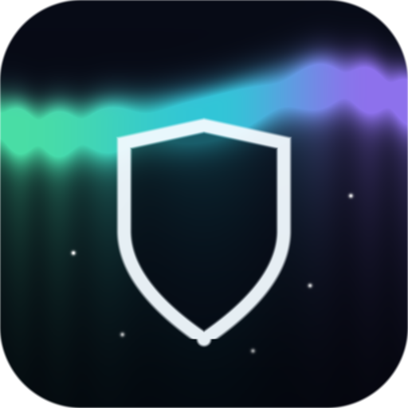
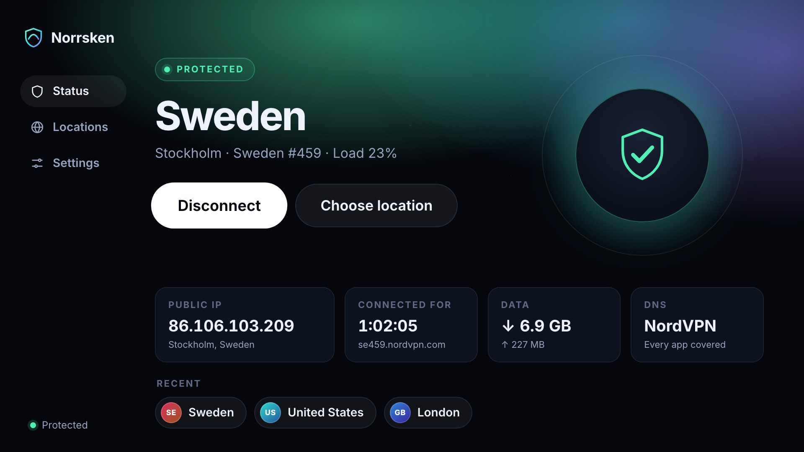
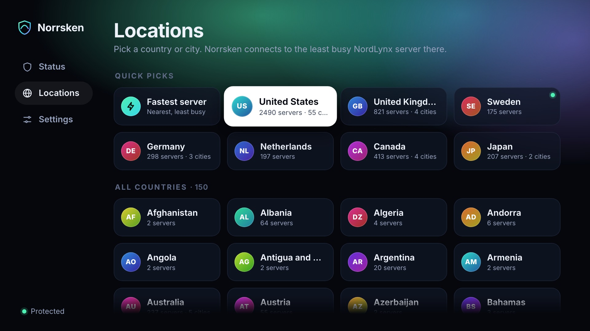
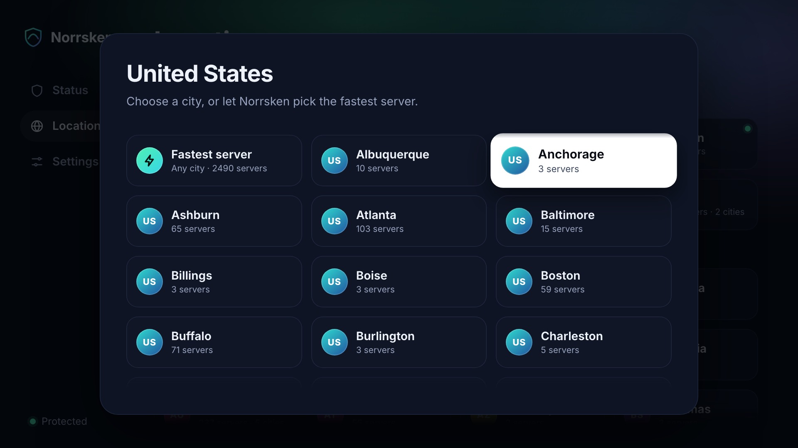
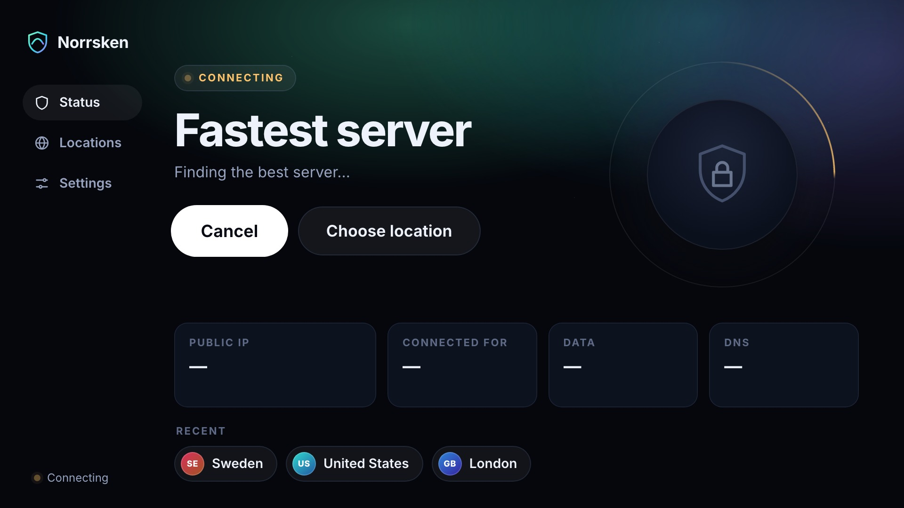
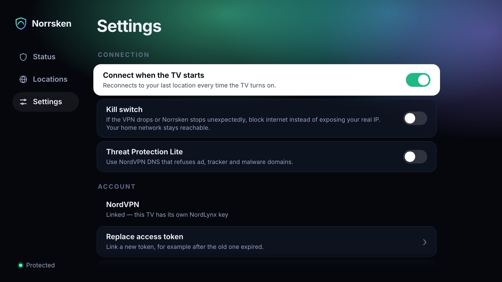
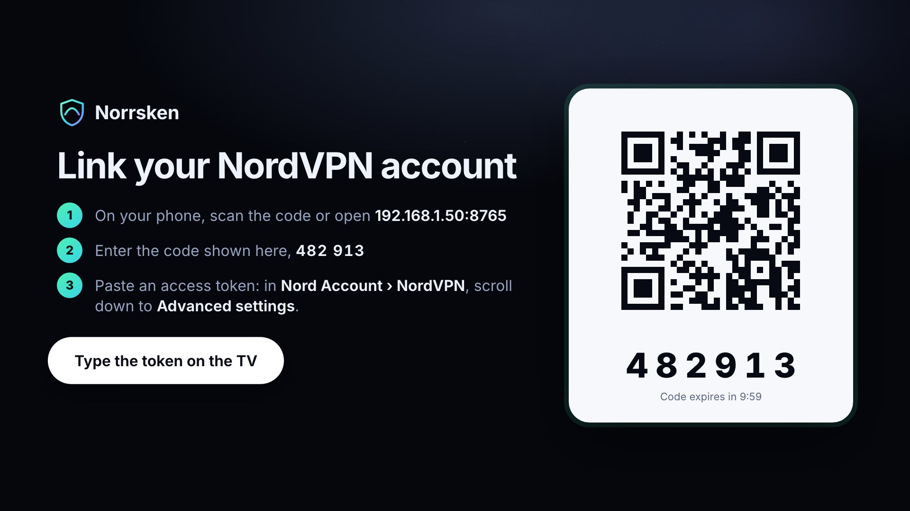
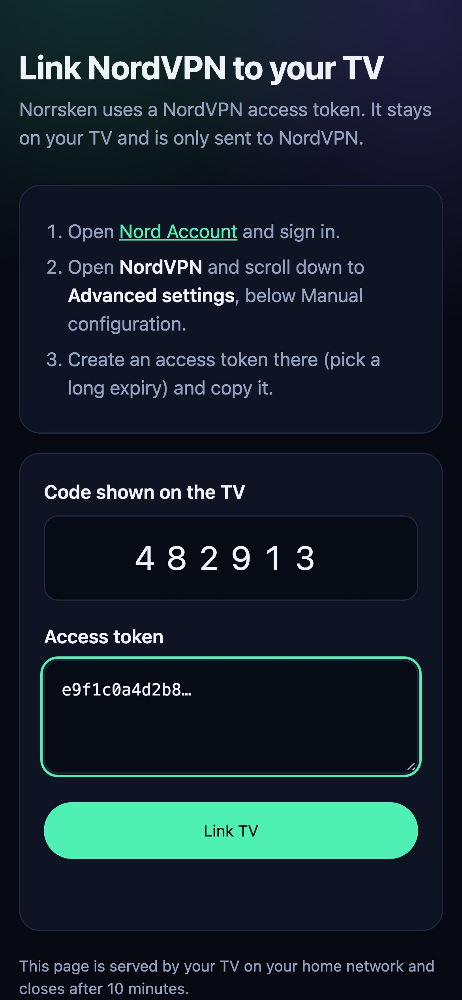
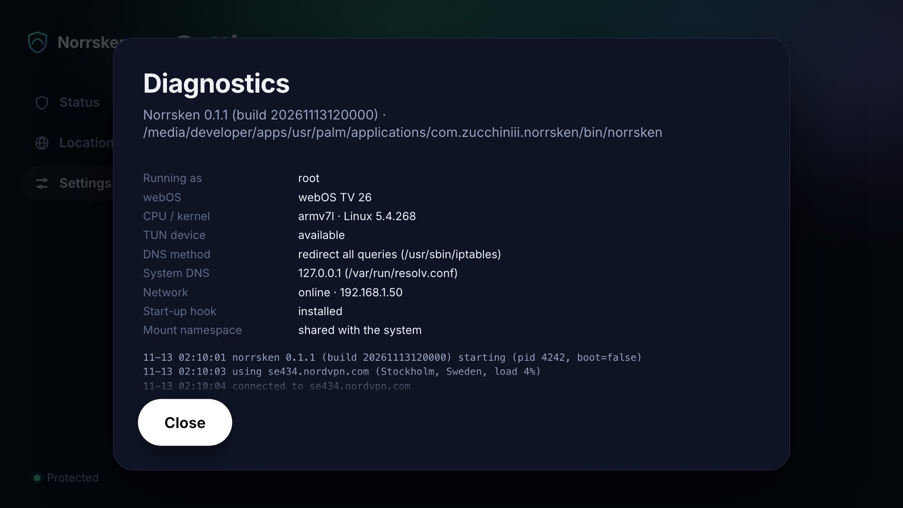

<p align="center">
  
</p>

<h1 align="center">Norrsken</h1>

<p align="center">
  <b>NordVPN for rooted LG webOS TVs</b><br>
  NordLynx (WireGuard) for the whole TV, with server choice and a 10-foot interface built for the remote.
</p>

<p align="center">
  <a href="https://github.com/Zucchiniii/norrsken/releases/latest"></a>
  <a href="https://github.com/Zucchiniii/norrsken/actions/workflows/test.yml"></a>
  <a href="LICENSE"></a>
  
</p>

<p align="center">
  
</p>

> [!IMPORTANT]
> Norrsken is an **unofficial** client and is not affiliated with Nord Security. You need your
> own NordVPN subscription and an LG TV that is **rooted** with Homebrew Channel.

## Contents

- [Features](#features)
- [Requirements](#requirements)
- [Install](#install)
  - [With Homebrew Channel (recommended)](#with-homebrew-channel-recommended)
  - [Manually from an IPK](#manually-from-an-ipk)
- [Get a NordVPN access token](#get-a-nordvpn-access-token)
- [Link your TV](#link-your-tv)
- [Using Norrsken](#using-norrsken)
- [Settings](#settings)
- [What happens while you're connected](#what-happens-while-youre-connected)
- [Updating and uninstalling](#updating-and-uninstalling)
- [Troubleshooting](#troubleshooting)
- [How it works](#how-it-works)
- [Privacy and security](#privacy-and-security)
- [Building from source](#building-from-source)
- [Status and limits](#status-and-limits)

## Features

- **The whole TV goes through the VPN.** Netflix, YouTube, the browser and every other app,
  not just one of them. Your home network stays local, so casting and the LG ThinQ app keep working.
- **NordLynx, NordVPN's WireGuard-based protocol.** Fast, and it runs in userspace, so it doesn't
  need a WireGuard kernel module, which LG TVs don't ship.
- **All of NordVPN's countries, plus cities.** Pick *Fastest server*, a country, or a city.
  Recent locations reconnect with one press.
- **Built for the remote.** Arrow keys, OK, Back, and the Magic Remote pointer.
  The red button connects or disconnects from anywhere.
- **Link with your phone.** Scan a QR code on the TV and paste your token on your phone, instead of
  typing 64 characters with the remote.
- **Leak protection.** DNS goes to NordVPN, IPv6 is blocked while connected, and an optional
  kill switch keeps you offline rather than exposed if the VPN drops.
- **Hands-off.** It can connect when the TV starts, fail over to another server when one stops
  answering, follow Wi-Fi ↔ Ethernet changes, and repair its own routes.
- **Cleans up after itself.** Every change to the TV's networking is journaled and undone on
  disconnect, even after a crash.

| | |
|:-:|:-:|
|  |  |
| **Locations**: quick picks and every country | **City picker** for countries with several cities |
|  |  |
| **Connecting** | **Settings** |

<sub>Screenshots are rendered from the app's built-in demo mode with sample data, at the TV's
1920×1080 resolution, by <a href="tools/screenshots.cjs">tools/screenshots.cjs</a>.</sub>

## Requirements

| | |
|---|---|
| **TV** | An LG webOS TV that is **rooted**, with [Homebrew Channel](https://github.com/webosbrew/webos-homebrew-channel) showing *Root status: ok*. Developer Mode alone is not enough, because creating a VPN tunnel needs root. See [CanI.RootMy.TV](https://cani.rootmy.tv/) for whether your firmware can be rooted. |
| **webOS** | Built for current models (webOS 25/26). Older rooted TVs on webOS 5 or newer are expected to work but haven't been tried. The binary is 32-bit ARM, which runs on both 32- and 64-bit LG TVs. |
| **NordVPN** | An active subscription and an [access token](#get-a-nordvpn-access-token). |

## Install

### With Homebrew Channel (recommended)

1. On the TV, open **Homebrew Channel**.
2. Go to **Settings → Add repository** and enter:

   ```text
   https://raw.githubusercontent.com/Zucchiniii/norrsken/main/homebrew-repository.json
   ```

3. Go back to the app list, open **Norrsken** and choose **Install**.
4. Start **Norrsken** from the TV's app bar.

Homebrew Channel also tells you when a new version is out.

<details>
<summary>Typing a URL with the remote is tedious. Prefill it from a computer instead.</summary>

With [`ares-cli`](https://webostv.developer.lge.com/develop/tools/cli-installation) configured for your TV:

```bash
ares-launch --device tv org.webosbrew.hbchannel -p '{"launchMode":"addRepository","url":"https://raw.githubusercontent.com/Zucchiniii/norrsken/main/homebrew-repository.json"}'
```

Then confirm **Add repository** on the TV.
</details>

### Manually from an IPK

Download `com.zucchiniii.norrsken_<version>_all.ipk` from the
[latest release](https://github.com/Zucchiniii/norrsken/releases/latest), then use one of these:

- **[webOS Dev Manager](https://github.com/webosbrew/dev-manager-desktop):** connect to your TV and
  drop the IPK onto it.
- **SSH** (root SSH turned on in Homebrew Channel). From a clone of this repository:

  ```bash
  ./install.sh <tv-ip> path/to/com.zucchiniii.norrsken_<version>_all.ipk
  ```

  This copies the IPK, installs it, and starts the app. Without an authorized SSH key it asks for
  the TV's root password.

## Get a NordVPN access token

Norrsken signs in with an access token rather than your password.

1. Sign in to **[Nord Account](https://my.nordaccount.com/)**.
2. Open **NordVPN**.
3. Scroll down to **Advanced settings**. It's *below* Manual configuration, not inside it.
4. Create an access token, pick a **long expiry**, and copy it.

The token is used once, to fetch the NordLynx key for your TV. If you ever revoke the token,
link the TV again from Settings.

## Link your TV

The first time you open Norrsken it shows a QR code and a 6-digit code.

<p align="center">
  
  &nbsp;
  
</p>

1. Scan the QR code with a phone on the **same network** as the TV. The page opens with the code filled in.
2. Paste your access token and tap **Link TV**.
3. The TV switches to the status screen by itself.

**No phone?** Choose **Type the token on the TV**. The LG ThinQ app's remote keyboard can paste
into that field.

The pairing page is served by the TV itself, only while the link screen is open. It closes after
10 minutes and locks after repeated wrong codes.

## Using Norrsken

| Remote | Does |
|---|---|
| Arrows, **OK**, **Back** | Move, select, go back. The Magic Remote pointer works too |
| **Red** button | Connect or disconnect from any screen |
| **CH+ / CH−** | Jump a page in the country list |

- **Quick connect** uses NordVPN's own recommendation: the nearest, least busy server.
- **Choose location** opens every country. Countries with several cities open a city picker, where
  *Fastest server* lets Norrsken choose within the country.
- **Recent** chips on the status screen reconnect to places you've used before.
- **Switching location while connected keeps the tunnel up**, so nothing leaks in between.

The status screen shows your public IP as NordVPN sees it, connection time, data used, and how DNS
is handled.

## Settings

**Connect when the TV starts**  
Reconnects to your last location every time the TV boots. Norrsken installs a small boot hook
(`/var/lib/webosbrew/init.d/60-norrsken`) and waits for the network before connecting.

**Kill switch**  
If the VPN drops, or Norrsken's background service stops unexpectedly, internet stays
**blocked** instead of falling back to your real IP. Your home network stays reachable.
While the kill switch is on, Norrsken keeps retrying servers and never lifts the block by itself;
pressing *Disconnect* turns the VPN and the block off. After a crash, opening the app clears it.

**Threat Protection Lite**  
Switches to NordVPN's filtering DNS, which refuses ad, tracker and malware domains.

**Account**  
*Replace access token* links a new token. *Unlink this TV* disconnects and deletes the stored
token and key.

**Diagnostics & log**  
Shows what Norrsken found on your TV (root, TUN device, DNS method, network) and the latest log
lines. Include a photo of it when reporting a problem.

<p align="center"></p>

## What happens while you're connected

- All IPv4 traffic is routed into a `nordlynx` interface, using the routes 0.0.0.0/1 and 128.0.0.0/1.
  Traffic for your LAN keeps its own, more specific route and stays local.
- The connection to the VPN server is pinned to your real gateway, so the tunnel can't loop into itself.
- **IPv6 is switched off** on the TV's network interfaces, because NordLynx carries only IPv4.
  It's restored when you disconnect.
- **DNS goes to NordVPN** through the tunnel. Norrsken picks the best method the TV supports:
  - **iptables redirect**, if the kernel supports NAT. Every port-53 query from every app is sent
    to a small forwarder in Norrsken, even from apps that hard-code `8.8.8.8`.
  - **resolv.conf override** otherwise: a bind mount over the system file. The original file is
    never edited.
- If a server stops answering, Norrsken moves to the next-best one. If the network changes,
  it re-pins the server route. If something deletes its routes, it puts them back.

## Updating and uninstalling

**Updating:** install the new version through Homebrew Channel. Norrsken notices that its
background service is from an older build, restarts it, and reconnects to where you were.

**Uninstalling:**

1. In Norrsken, choose **Settings → Unlink this TV**. This removes the stored token and key.
2. Remove the app with Homebrew Channel (or the TV's own app manager).

The boot hook removes itself once the app is gone. To remove everything by hand over SSH:

```bash
rm -rf /var/lib/webosbrew/norrsken /var/lib/webosbrew/init.d/60-norrsken
```

## Troubleshooting

<details>
<summary><b>"Norrsken needs a rooted TV" or "Homebrew Channel is missing"</b></summary>

Norrsken runs its VPN engine as root through Homebrew Channel's root service. Open Homebrew
Channel and check that *Root status* says ok. A TV in Developer Mode without root can't create a
VPN tunnel.
</details>

<details>
<summary><b>"NordVPN rejected this access token"</b></summary>

Create a new token: Nord Account → NordVPN → scroll down to **Advanced settings**. Copy the
whole token without spaces, and pick a long expiry so you don't have to relink soon.
</details>

<details>
<summary><b>My phone can't open the pairing page</b></summary>

The phone must be on the same network as the TV. Guest Wi-Fi and "client isolation" on some
routers block it. Try the address shown on the TV directly in the phone's browser, or choose
**Type the token on the TV**.
</details>

<details>
<summary><b>Connected, but a streaming app says it detected a VPN or proxy</b></summary>

That's decided by the streaming service and NordVPN's server IPs. Try another server or city in
the same country.
</details>

<details>
<summary><b>No internet after the app crashed (kill switch on)</b></summary>

This is the kill switch working. Open Norrsken: it restarts its service, which reconnects or
clears the block. Rebooting the TV clears it as well.
</details>

<details>
<summary><b>The DNS card says "Not overridden"</b></summary>

The TV supported neither iptables NAT nor a bind mount over resolv.conf. Traffic is still
encrypted, but DNS queries go to your normal DNS server. Please open an issue and include a photo
of **Settings → Diagnostics**.
</details>

<details>
<summary><b>Commands over SSH</b></summary>

```bash
N=/media/developer/apps/usr/palm/applications/com.zucchiniii.norrsken/bin/norrsken
$N diag                                  # environment report
$N ctl-json '{"cmd":"status"}'           # live state as JSON
tail -f /var/lib/webosbrew/norrsken/norrsken.log
$N stop                                  # disconnect and stop the background service
```
</details>

## How it works

```
 Norrsken app (HTML/JS, the TV UI)
   │  luna://org.webosbrew.hbchannel.service/exec   (root)
   ▼
 bin/norrsken ctl <request> ──unix socket──▶ norrsken daemon (Go, static ARMv7)
                                             ├─ NordVPN API: token → NordLynx key, server picks
                                             ├─ wireguard-go on /dev/net/tun → "nordlynx"
                                             ├─ netlink routes, IPv6 guard, kill switch
                                             ├─ DNS: iptables redirect + forwarder, or resolv.conf mount
                                             └─ pairing page (only while the link screen is open)
```

- `app/` is the TV interface: plain HTML, CSS and JavaScript, with spatial navigation for the remote.
- `daemon/` is the root service. It's a single static Go binary and starts on demand.
- Requests from the UI go through Homebrew Channel's root `exec` service to `norrsken ctl`. That
  forwards them to the long-running daemon, starting it if needed.
- Every system change is written to `restore.json` before it's made. If a daemon crashes, the next
  one undoes whatever was left behind.

## Privacy and security

- **Stored on the TV:** your access token and NordLynx private key, in
  `/var/lib/webosbrew/norrsken/config.json` (readable by root only). Both are redacted from the log.
- **Sent to NordVPN:** the token, once, to fetch the key. After that, only anonymous
  server-list requests, plus a "what's my IP" check after connecting.
- **Sent anywhere else:** nothing. There is no analytics or telemetry.
- **Pairing page:** plain HTTP on your home network, open only while the link screen is showing.
  It accepts a token only together with the 6-digit code from the TV, locks after 8 wrong codes,
  and shuts down after 10 minutes.
- **On your network:** the background service listens on a root-only unix socket.
  It opens no network ports except the pairing page while you're linking.

Found a security issue? Please open a private
[security advisory](https://github.com/Zucchiniii/norrsken/security/advisories/new) rather than a public issue.

## Building from source

You need Go 1.27+ and Node.js (for `ares-package`). Docker is optional, for the end-to-end test.

```bash
git clone https://github.com/Zucchiniii/norrsken && cd norrsken
./build.sh                 # tests the daemon, cross-compiles it, packages dist/*.ipk
./install.sh <tv-ip>       # optional: install over SSH
```

| | |
|---|---|
| `cd daemon && go test ./...` | Unit tests: API parsing, DNS failover, connect/switch/disconnect, pairing, kill switch, log redaction |
| `./test/integration.sh` | End-to-end test in Docker (details below) |
| `python3 -m http.server -d app 8137` | The UI in a browser with demo data: `/?demo=connected`, `?demo=unlinked`, `?demo=blocked` |
| `node tools/screenshots.cjs` | Re-render the screenshots in `docs/screenshots` (needs Playwright) |
| `./release.sh` | Build, test and publish a GitHub release (bump `version` in `app/appinfo.json` first) |

The end-to-end test runs the real ARMv7 binary in an emulated "TV" container. It talks to two
userspace WireGuard servers and a fake NordVPN API, and checks:

- traffic really goes through the tunnel
- the TV fails over when a server is down
- switching servers keeps the same interface
- routes repair themselves
- the kill switch blocks traffic after a crash, and the next daemon recovers
- IPv6 and DNS are restored on disconnect
- connect-at-boot works
- an app update replaces the old daemon and reconnects

## Status and limits

Norrsken is young (0.1.x) and has been built for an LG C5. Bug reports from any model, with a photo of
**Settings → Diagnostics**, are very welcome.

- NordLynx only: no OpenVPN, obfuscated, Double VPN, Onion or dedicated-IP servers, and no Meshnet.
- IPv4 only. IPv6 is blocked while connected, not tunnelled.
- The kill switch protects from the moment the tunnel is up. Right after power-on, apps can reach
  the internet for the few seconds before *Connect when the TV starts* has finished.
- The iptables DNS-redirect path depends on your TV's kernel. Docker Desktop's kernel can't run it,
  so the Docker end-to-end test covers the resolv.conf fallback, and the forwarder is unit-tested.

## License

[MIT](LICENSE). Third-party components and their licenses are listed in
[THIRD_PARTY_NOTICES.md](THIRD_PARTY_NOTICES.md). NordVPN and NordLynx are trademarks of
Nord Security.
